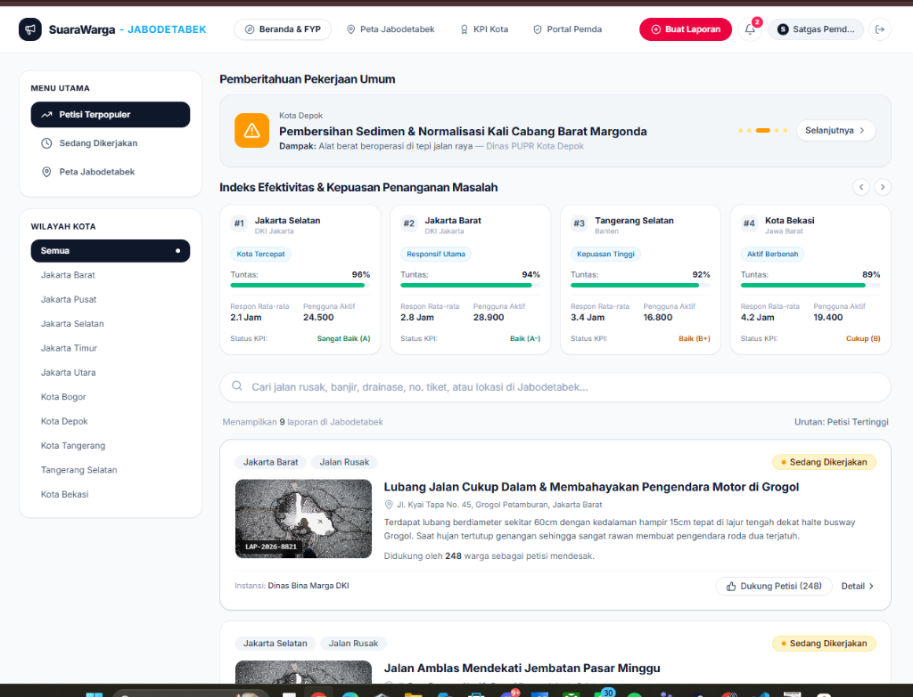
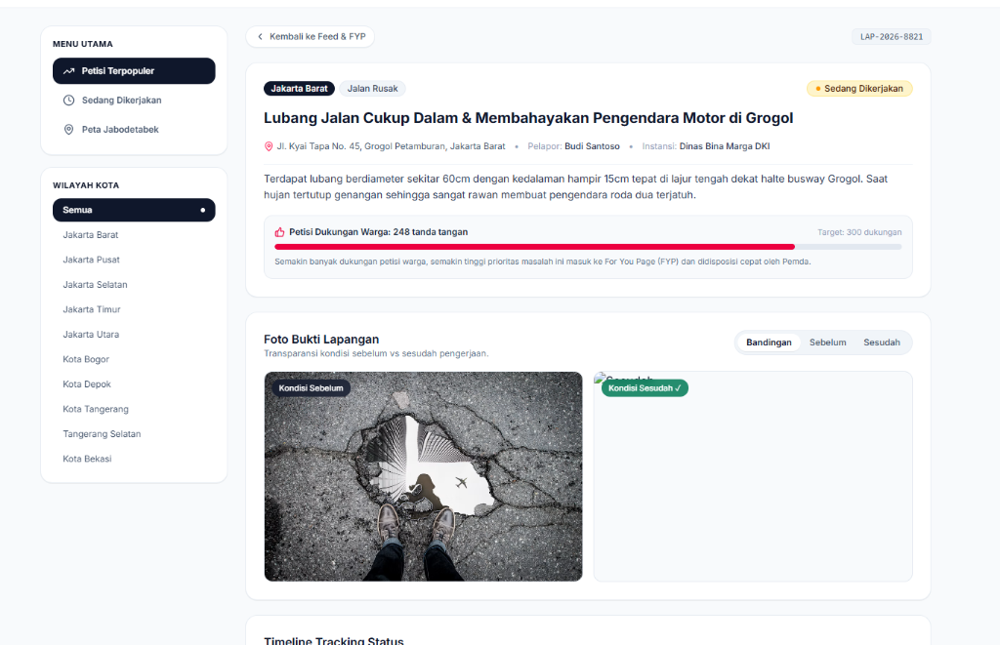
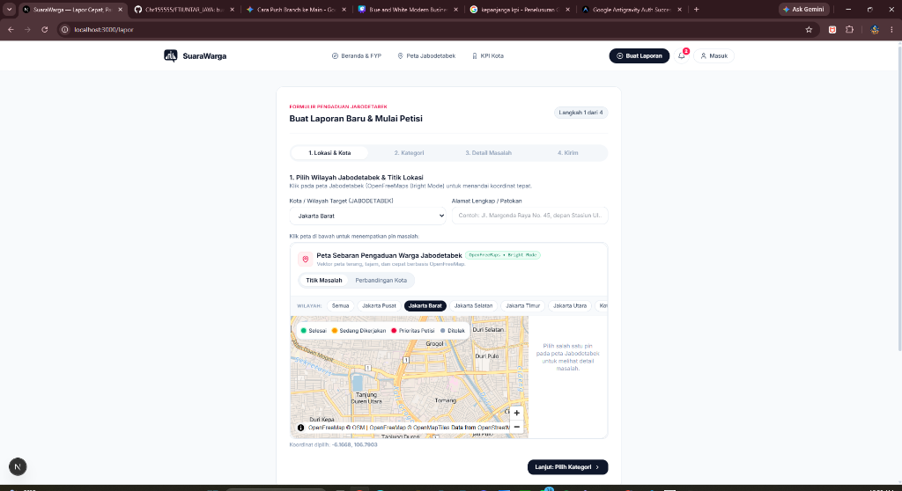
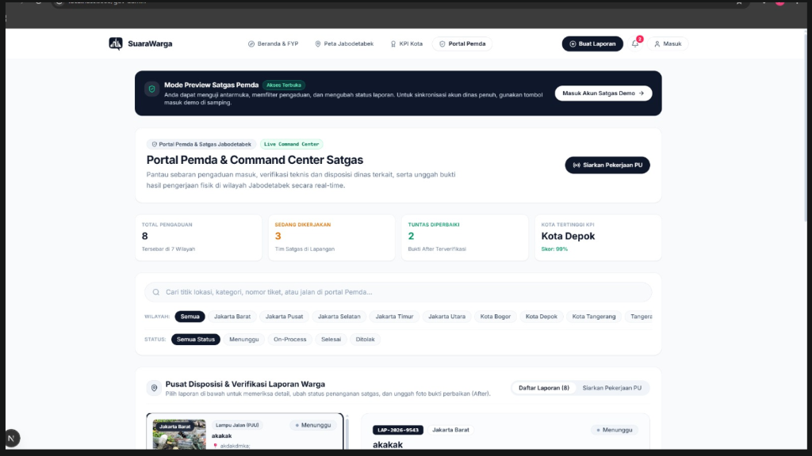
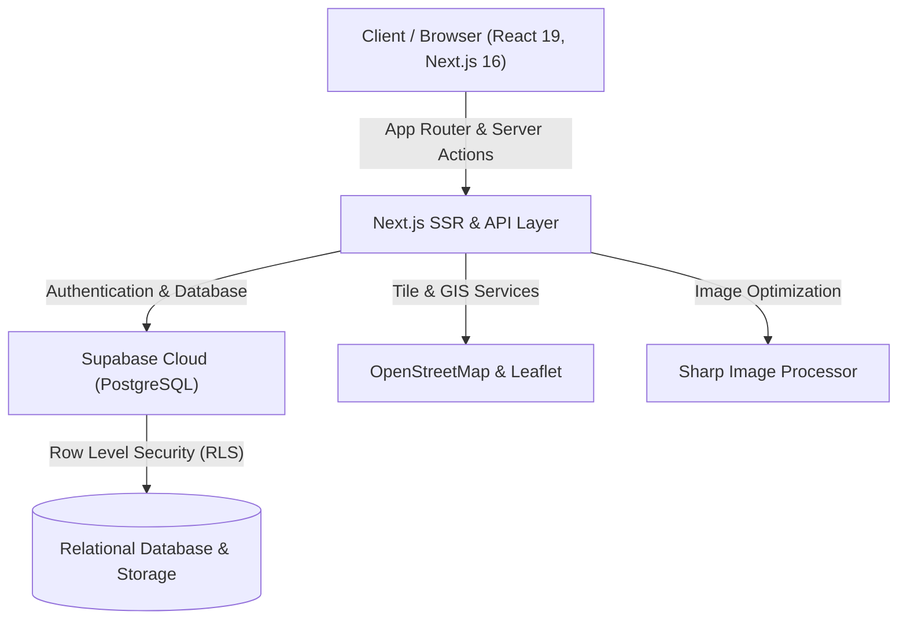

<div align="center">

# 🏛️ SUARAWARGA
### Platform Pengaduan Infrastruktur Publik & Akuntabilitas Kinerja Pemda Se-Jabodetabek

[](https://nextjs.org/)
[](https://react.dev/)
[](https://tailwindcss.com/)
[](https://supabase.com/)
[](https://www.typescriptlang.org/)
[]()

**Web In Action (WIA) 2026 — Designing Digital Futures**  
*Subtema: Open Government Data, Public Service Tracking, Civic Reporting & Accountability, Data-Driven Decision Support*

[🌐 Live Demo Website](https://ftiuntar-jaya.vercel.app) • [📊 Dokumen Pitch Deck & Canva](https://canva.link/0f8ksondze6alti) • [💻 GitHub Repository](https://github.com/Chr155555/FTIUNTAR_JAYA)

---

</div>

## 📌 1. Informasi Tim & Karya Lomba

| Identitas | Keterangan |
| :--- | :--- |
| **Nama Tim** | **FTI UNTAR JAYA** |
| **Institusi** | Fakultas Teknologi Informasi, Universitas Tarumanagara (UNTAR) |
| **Judul Karya** | **SUARAWARGA** |
| **Cabang Lomba** | Web In Action (WIA) 2026 |
| **Tema Utama** | *Designing Digital Futures* |
| **Subtema Pilihan** | *Open Government Data, Public Service Tracking, Civic Reporting & Accountability, Data-Driven Decision Support* |
| **Mentor Penilai** | **Adi Prabowo** |

---

## 📖 2. Latar Belakang & Masalah (*Problem Statement*)

Wilayah aglomerasi **Jabodetabek** (Jakarta, Bogor, Depok, Tangerang, Bekasi) menampung lebih dari 30 juta penduduk dengan mobilitas lintas-wilayah yang sangat tinggi. Namun, pengelolaan fasilitas dan infrastruktur publik menghadapi sejumlah hambatan sistemik:

1. **Silo Birokrasi Antar-Daerah & Ketidakjelasan Disposisi Dinas:**
   Warga seringkali kebingungan menentukan instansi mana yang berwenang (apakah jalan nasional, jalan provinsi, atau jalan lingkungan), menyebabkan aduan terombang-ambing tanpa tindak lanjut.
2. **Ketiadaan Transparansi Pelacakan (*Black Box Service Tracking*):**
   Aduan konvensional via media sosial atau formulir manual tidak memiliki linimasa progres yang jelas. Warga tidak tahu apakah laporan sedang diverifikasi, satgas sudah bergerak, atau terkendala anggaran.
3. **Klaim Penyelesaian Sepihak Tanpa Validasi Warga:**
   Sering terjadi laporan ditutup oleh oknum petugas dengan status *"Selesai"* tanpa adanya bukti fisik perbaikan yang dapat diaudit publik.
4. **Keputusan Pemda Belum Berbasis Data Spasial Agregat (*Lack of Data-Driven Decision Making*):**
   Pemerintah daerah kesulitan memetakan kluster masalah dominan secara makro, mengakibatkan alokasi armada satgas dan anggaran perbaikan sering tidak tepat sasaran.

---

## 🎯 3. Visi, Solusi & Nilai Dampak (*Value Proposition*)

**SuaraWarga** hadir sebagai jembatan dua arah (*civic-tech platform*) berbasis geospasial real-time yang mengedepankan transparansi, audit partisipatif warga, dan pendukung keputusan berbasis data:

- ⚡ **Pelaporan Geospasial Instan (< 60 Detik):** Pinpoint koordinat GPS otomatis, pemilihan kategori multi-sektor, dan unggah foto bukti kerusakan.
- ⏱️ **Sistem Pelacakan Status Real-Time (*Real-Time Status Tracking System*):** Linimasa transparan dari `Menunggu Verifikasi` $\rightarrow$ `Sedang Dikerjakan Satgas` $\rightarrow$ `Selesai Berbukti Foto After` $\rightarrow$ `Audit Warga`.
- 🛡️ **Mekanisme Penalti KPI oleh Warga:** Pertama di Indonesia, warga dapat melayangkan *Komplain Penalti KPI* (-1.5 poin) jika perbaikan diklaim fiktif, menjaga akuntabilitas aparatur dinas secara objektif.
- 📊 **Dashboard Analitik & Visualisasi Data Publik (*Data-Driven Decision Support*):** Grafik interaktif yang merangkum sebaran masalah lintas wilayah untuk membantu instansi pemda mengalokasikan armada satgas secara presisi.

---

## 🖥️ 4. Tampilan Antarmuka Website (*Screenshot Walkthrough*)

Berikut tangkapan layar antarmuka utama sistem SuaraWarga:

| 1. Landing Page & Feed FYP Laporan Warga | 2. Peta Interaktif Sebaran Pengaduan Jabodetabek |
| :---: | :---: |
|  |  |
| *Ringkasan statistik real-time, feed laporan komunitas, dan upvote dukungan.* | *Peta OpenStreetMap dengan visualisasi sebaran koordinat dan status perbaikan.* |

| 3. Formulir Lapor Cepat 4 Langkah & GPS | 4. Portal Command Center Satgas Pemda |
| :---: | :---: |
|  |  |
| *Deteksi lokasi akurat, kategori cerdas, estimasi SLA, dan unggah foto bukti.* | *Verifikasi teknis, disposisi dinas terkait, dan upload foto bukti After.* |

---

## 🚀 5. Fitur Unggulan Sistem

### A. Fitur untuk Warga (Citizen-Centric)
- **Pelaporan Spasial Interaktif:** Pemetaan titik kerusakan berbasis peta digital OpenStreetMap / Leaflet dengan auto-detect wilayah kota.
- **Sistem Dukungan Petisi (*Upvoting*):** Laporan dengan dukungan suara terbanyak otomatis naik ke banner prioritas utama (*Trending Issue*).
- **Linimasa Penanganan Bertahap:** Notifikasi progres pengerjaan lapangan secara real-time.
- **Audit Hasil Perbaikan (*Before vs After Comparison*):** Transparansi foto sebelum dan sesudah dikerjakan dinas terkait.

### B. Fitur untuk Satgas & Dinas Pemda (Government Operations)
- **Auto-Routing Cerdas ke Dinas Berwenang:**
  - 🚗 *Jalan Rusak & Ambles* $\rightarrow$ **Dinas Bina Marga**
  - 🌊 *Banjir & Drainase Mampet* $\rightarrow$ **Dinas Sumber Daya Air (SDA)**
  - 💡 *Lampu Jalan (PJU) Padam* $\rightarrow$ **Dinas Perhubungan (Dishub)**
  - 🗑️ *Sampah Liar* $\rightarrow$ **Dinas Lingkungan Hidup (DLH)**
  - 🌳 *Fasilitas Umum & Taman* $\rightarrow$ **Dinas Pertamanan & Perumahan**
- **Disposisi & Update Status Lapangan:** Satgas dapat mengubah status laporan menjadi `On-Process` dan mengunggah foto bukti penyelesaian.
- **Siarkan Pekerjaan PU:** Menampilkan banner pengumuman pekerjaan pemeliharaan jalan berkala di beranda publik.

### C. Dashboard Analitik & Pengambil Kebijakan (Data-Driven Decision Making)
- **Grafik Distribusi Isu Wilayah:** Visualisasi proporsi keluhan masyarakat per kategori (Bar & Donut Visualizer).
- **Matriks Isu Dominan Lintas-Kota:** Komparasi masalah paling mendesak di 7 kota/kabupaten Jabodetabek.
- **Indeks Evaluasi & Benchmark SLA:** Pengukuran respon rata-rata vs standar target pelayanan publik (&le; 4 jam).
- **Rekomendasi Kebijakan Otomatis:** Saran strategis alokasi satgas dinas dan logistik berdasarkan wilayah aduan tertinggi.
- **Ekspor Dataset CSV & Ringkasan Eksekutif:** Memudahkan pelaporan berkala untuk rapat koordinasi dinas.

---

## 🔑 6. Akun Pengujian Demo (*Demo Credentials*)

Untuk memudahkan pengujian fungsionalitas multi-peran pada evaluasi lomba, gunakan akun berikut:

| Peran Akun (*Role*) | Alamat Email | Kata Sandi (*Password*) | Hak Akses Utama |
| :--- | :--- | :--- | :--- |
| **Warga Biasa (Citizen)** | `budi@gmail.com` | `password123` | Membuat laporan, upvote aduan, komplain penalti KPI, pantau riwayat di Profil. |
| **Satgas Pemda (Gov Staff)** | `pemda@jakbar.go.id` | `password123` | Akses Portal Command Center Pemda, verifikasi aduan, ubah status, unggah foto After. |
| **Super Admin Platform** | `admin@suarawarga.id` | `admin123` | Akses Admin Panel, moderasi konten, manajemen pendaftaran dinas kota baru. |

---

## 🛠️ 7. Arsitektur & Teknologi (*Tech Stack*)



- **Frontend Framework:** Next.js 16.4.3 (App Router, Server & Client Components)
- **UI Library:** React 19.3.0, Tailwind CSS v4, Lucide React Icons
- **GIS & Mapping:** Leaflet 1.9.4, OpenStreetMap Tiles, MapLibre GL
- **Backend & Cloud Database:** Supabase (PostgreSQL, Row-Level Security, Supabase SSR Auth, Realtime)
- **Image Processing:** Sharp (Optimasi aset foto dan multi-resolution favicon)
- **Type Safety:** TypeScript 5.0, Zod Validation

---

## 💻 8. Panduan Instalasi & Menjalankan di Lokal (*Local Setup*)

Ikuti langkah-langkah berikut untuk menjalankan repositori ini di komputer lokal:

### 1. Prasyarat Sistem
- **Node.js** versi `18.18.0` atau lebih baru (disarankan Node.js 20 LTS / 22)
- **npm** (atau `pnpm` / `yarn`)
- **Git**

### 2. Kloning Repositori
```bash
git clone https://github.com/Chr155555/FTIUNTAR_JAYA.git
cd FTIUNTAR_JAYA
```

### 3. Instal Dependensi
```bash
npm install
```

### 4. Konfigurasi Environment Variables
Salin file `.env.example` atau buat file baru bernama `.env.local` di direktori utama:
```env
NEXT_PUBLIC_SUPABASE_URL=your_supabase_project_url
NEXT_PUBLIC_SUPABASE_ANON_KEY=your_supabase_anon_key
SUPABASE_SERVICE_ROLE_KEY=your_supabase_service_role_key
```

### 5. Jalankan Server Pengembangan
```bash
npm run dev
```
Buka browser dan akses antarmuka di `http://localhost:3000`.

### 6. Build untuk Production
```bash
npm run build
npm run start
```

---

## 📈 9. Tindak Lanjut Catatan & Saran Mentor Penilai

Berikut rekapitulasi pengembangan yang telah diimplementasikan sebagai respons terhadap lembar catatan **Mentor Adi Prabowo (FDS WIA 2026)**:

| Saran Mentor Penilai | Implementasi Solusi di SuaraWarga | Status |
| :--- | :--- | :---: |
| **1. Fitur Pelacakan Aspirasi (*Tracking System*)**<br>*"Tambahkan fitur status real-time menggunakan progress bar atau linimasa interaktif."* | • Implementasi stepper status horizontal 4 tahap di detail aduan.<br>• Persentase progres di kartu profil warga (*On-Process 65%*).<br>• Linimasa interaktif lengkap dengan penanda jam & tanggal pengerjaan dinas. | ✅ **Selesai** |
| **2. Dashboard Analitik & Visualisasi Data Publik**<br>*"Kembangkan halaman analitik berupa grafik atau peta interaktif yang merangkum isu-isu paling sering dilaporkan di suatu wilayah."* | • Pembuatan komponen `PublicAnalyticsDashboard.tsx` di `/kpi`.<br>• Visualisasi bar & donut proporsi keluhan 5 dinas se-Jabodetabek.<br>• Matriks isu dominan per kota & komparasi target SLA kecepatan respon.<br>• Panel Rekomendasi Kebijakan (*Data-Driven Policy*) & Ekspor CSV. | ✅ **Selesai** |
| **3. Fitur Kategori & Filter Cerdas**<br>*"Sediakan sistem tag/kategori spesifik disertai fitur pencarian cepat agar pengguna menemukan aduan serupa."* | • Pengelompokan multi-sektor: Fisik, Drainase, PJU, Kebersihan, dan Faskes.<br>• Auto-routing terintegrasi ke 5 instansi dinas terkait.<br>• Filter instan per kota dan pencarian teks cepat. | ✅ **Selesai** |
| **4. Kelengkapan Repository & README.md**<br>*"Memuat README lengkap (deskripsi, tech stack, cara run, progress) & screenshot antarmuka."* | • Penyusunan dokumentasi komprehensif, arsitektur sistem, akun demo, panduan instalasi lokal, dan galeri screenshot halaman wajib FDS. | ✅ **Selesai** |

---

## 👥 10. Anggota Tim Pengembang

**Tim FTI UNTAR JAYA — Universitas Tarumanagara**
- **Ketua Tim & Fullstack Developer:** Christopher (FTI UNTAR)
- **UI/UX Designer & Frontend Developer:** Tim FTI UNTAR JAYA
- **Data Analyst & Quality Assurance:** Tim FTI UNTAR JAYA

---

<div align="center">
  <p>Dibuat dengan dedikasi untuk transparansi tata kelola infrastruktur perkotaan Indonesia yang lebih baik.</p>
  <p><strong>© 2026 SuaraWarga • FTI UNTAR JAYA • Web In Action 2026</strong></p>
</div>
